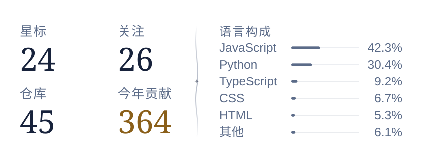

<picture>
  <source media="(prefers-color-scheme: dark)" srcset="assets/hero-dark.svg">
  
</picture>

[博客](https://blog.bakadax.top) / [B站](https://space.bilibili.com/38707901) / [邮箱](mailto:bakadax@qq.com)

I build small tools for whatever I'm into. My notes are in Chinese.

## 关于

我是达X，名字是随手敲出来的，用了七八年。后来做了个梦，梦里有一句「用心织梦，以梦织星」，觉得好听，就又给自己取了个名字叫未來星織——顺带解决了日文名字不好念的问题。没什么讲究。

另外，我也在 [AIcarusDev](https://github.com/AIcarusDev) 这个组织里写代码：[AIcarusCore](https://github.com/AIcarusDev/AIcarusCore) 是个多层意识 AI 框架，还有协议、适配器、TTS 和记忆的仓库。

技术之外，我在博客里写很长的东西：心理学、哲学、技术笔记，还有 galgame 的游玩记录。写得慢，但都是自己想弄明白的事。

## 现在

这段时间在给 DeepSeek Harness 写插件，陆续攒了近十个：[Chrome Bridge](https://github.com/Dax233/dsh-chrome-bridge) 把真实浏览器接进来，[Codex Bridge](https://github.com/Dax233/dsh-codex-bridge) 盯着本机的 Codex 线程，[Desktop Notify](https://github.com/Dax233/dsh-desktop-notify) 在任务跑完或出错时弹个 Windows 通知，[Delete Guard](https://github.com/Dax233/dsh-delete-guard) 专门挡那些被串起来、套起来的删除命令；[Session Bridge](https://github.com/Dax233/dsh-session-bridge) 是在上游基础上补了跨工作区全文检索。都收在 [dsh-plugins](https://github.com/Dax233/dsh-plugins) 索引里，一行命令装一个——解决的都只是我每天会遇到的琐事。

你在用 DSH 的话，欢迎拿去试试；缺什么，去仓库提个 issue 就好。

## 做过的一些东西

- **[AICPxlsUnpacker](https://github.com/Dax233/AICPxlsUnpacker)**：拆 Alice In Cradle 资源包
- **[DaY-Core](https://github.com/Dax233/DaY-Core)**：自用 QQ 机器人内核「达Y」
- **[The_Labyrinth_of_Imagination](https://github.com/Dax233/The_Labyrinth_of_Imagination)**：纯文字迷宫，渲染器是你的大脑
- **[Hdream-DAX](https://github.com/Dax233/Hdream-DAX)**：修好跑不动的 Hdream 模板
- **[Tools](https://github.com/Dax233/Tools)**：杂七杂八的自制小工具
- **[Ehpreview](https://github.com/Dax233/Ehpreview) / [UrlPreview](https://github.com/Dax233/UrlPreview)**：给 QQ 机器人用的链接预览

## 写过的一些东西

- [第一本能与第二本能](https://blog.bakadax.top/?post=33)——意识为什么存在？我把这个问题拆成了两条公理。
- [一次 galgame 文本破解](https://blog.bakadax.top/?post=25)——从乱码到能读能写，一个门外汉的逆向记录。
- [Word 公式排版](https://blog.bakadax.top/?post=31)——跟 Word 的公式编辑器较劲，找回旧式排版。

## 工具箱

日常是 Windows 和 Chrome；小工具大多用 Python，插件用 JavaScript / TypeScript，做网页就回头碰 CSS 和 PHP。

## 数字

<picture>
  <source media="(prefers-color-scheme: dark)" srcset="assets/stats-dark.svg">
  
</picture>

数据来自 GitHub 公开数据 · 每日自动更新

## 贡献

<picture>
  <source media="(prefers-color-scheme: dark)" srcset="https://raw.githubusercontent.com/Dax233/Dax233/output/github-contribution-grid-snake-dark.svg">
  <source media="(prefers-color-scheme: light)" srcset="https://raw.githubusercontent.com/Dax233/Dax233/output/github-contribution-grid-snake.svg">
  
</picture>

---

这里的东西大多是自己要用才写的，做完顺手放上来。更多碎碎念在 [达Xの小窝](https://blog.bakadax.top)。
